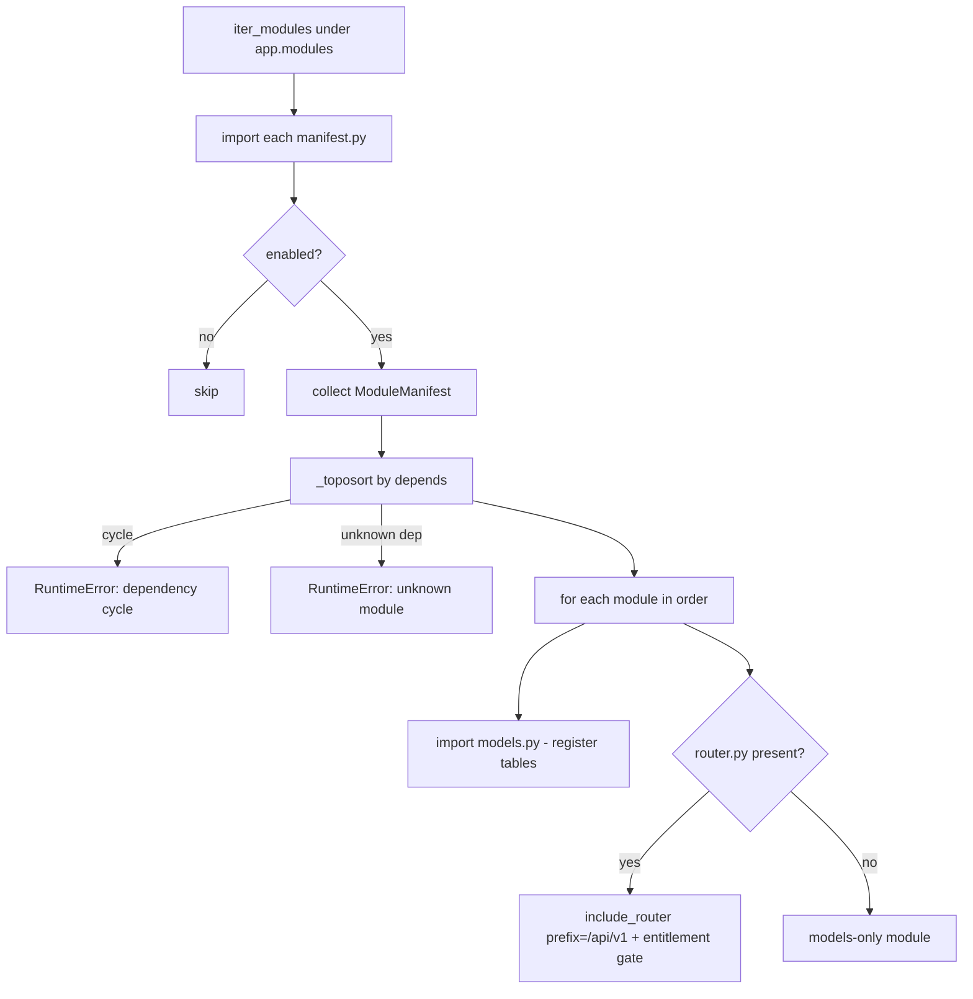
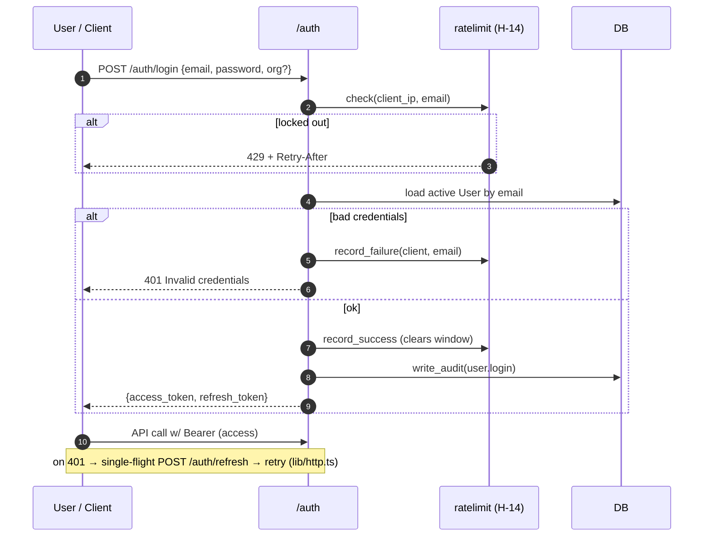
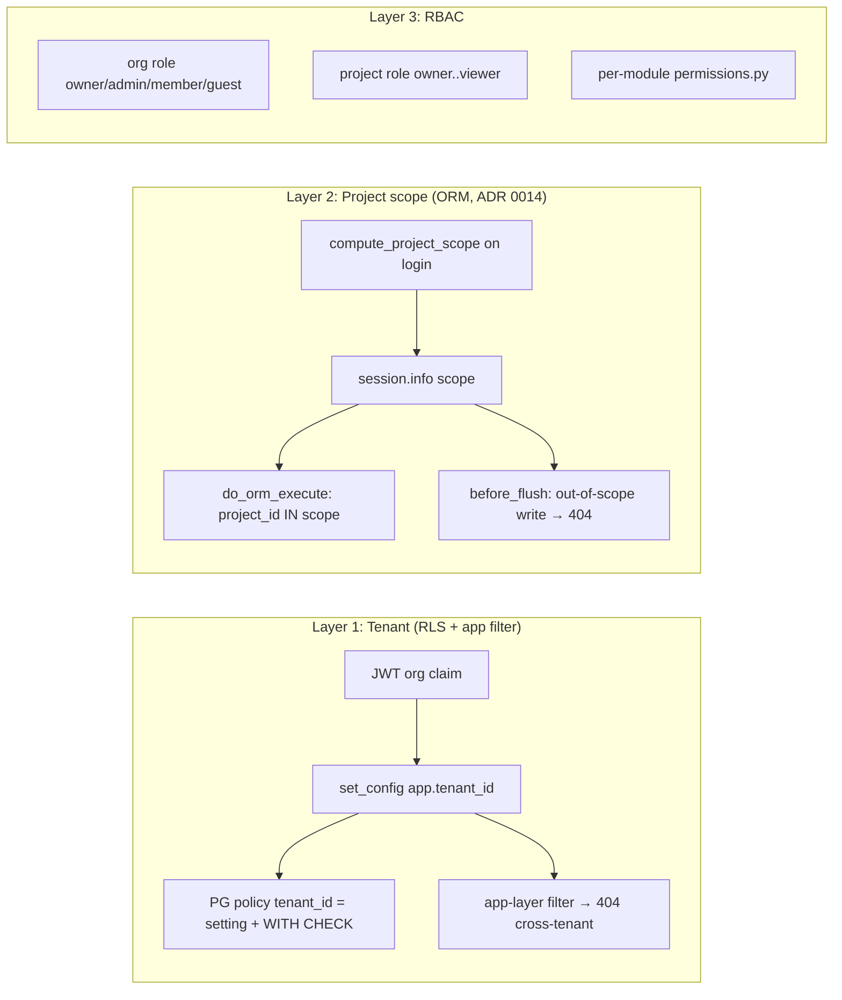

# Inspection ERP — Architecture Documentation Suite
## Part 1 · Main Application & Core Architecture

> **Scope of this document.** This is **Part 1** of a three-part architectural
> reverse-engineering suite. It covers the top-level application framework,
> runtime, global infrastructure, and the cross-cutting platform concerns
> (tenancy, auth, governance). Part 2 (mandatory base modules) and Part 3
> (optional/pluggable feature modules) are separate deliverables.
>
> Every statement below is grounded in a concrete file in this repository;
> paths are given as `path/to/file.py:line` where a specific implementation is
> referenced. Nothing here is inferred beyond what the source shows.

---

## 1. Technology Stack & Runtime Environment

### 1.1 Core languages & runtimes

| Concern | Choice | Evidence |
|---|---|---|
| Backend language | **Python**, `requires-python = ">=3.11"`; CI pins **3.12**; ruff/mypy target `py311` | `backend/pyproject.toml:5,32,38`; `.github/workflows/ci.yml` (`python-version: "3.12"`) |
| Backend package manager | **uv** (venv + `uv pip install -e ".[dev]"`); setuptools build backend | `README.md` quick-start; `backend/pyproject.toml:55-60` |
| ASGI server | **uvicorn[standard]** ≥ 0.30, run via the app factory (`--factory app.main:create_app`) | `backend/pyproject.toml:8`; `Makefile` (`backend:` target) |
| Frontend language | **TypeScript** 5.5 (strict; `tsc --noEmit` gate) | `frontend/package.json:9,38` |
| Frontend package manager | **npm** (`npm ci` in CI, `package-lock.json`) | `.github/workflows/ci.yml` (frontend job) |
| Node runtime (CI/build) | **Node 22** | `.github/workflows/ci.yml` (`node-version: "22"`) |

### 1.2 Frameworks & core libraries

**Backend** (`backend/pyproject.toml`)

- **Web/API:** FastAPI ≥ 0.115 (Starlette underneath — middleware base classes are
  used directly, e.g. `app/core/security_headers.py:15`).
- **ORM:** SQLAlchemy ≥ 2.0 (modern `DeclarativeBase` / `Mapped[...]` style —
  `app/database.py:78`).
- **Validation / settings:** Pydantic v2 (`pydantic[email]`) + `pydantic-settings`
  (12-factor env config — `app/config.py`).
- **Auth primitives:** PyJWT ≥ 2.8 (`HS256`); password hashing via **stdlib
  `hashlib.scrypt`** (no bcrypt/argon dependency — ADR 0001, `app/core/auth/security.py:14-35`).
- **Reporting:** ReportLab ≥ 4.2 (PDF) + openpyxl ≥ 3.1 (Excel) — ADR 0006.
- **Migrations:** Alembic ≥ 1.13.
- **HTTP client:** httpx ≥ 0.27 (also the test client transport).
- **Optional extras:** `psycopg[binary]` (the `postgres` extra), `boto3` (the `s3` extra).

**Frontend** (`frontend/package.json`)

- **UI:** React 18.3 + React DOM; **Vite 5** dev server / bundler.
- **Routing:** `react-router-dom` 6.26.
- **Server state:** **TanStack Query** 5 — the only sanctioned way to hold server
  state (`docs/architecture.md §5`).
- **i18n:** `i18next` + `react-i18next` (every user-visible string via `t()`; the
  terminology/label-override layer resolves through the same mechanism).
- **Styling:** Tailwind CSS 3.4 (+ `class-variance-authority`, `clsx`,
  `tailwind-merge`) — the design system is Tailwind + shadcn-style primitives.
- **Typed API client:** `openapi-typescript` generates `src/api/schema.d.ts` from
  the live backend OpenAPI document (`npm run gen:api`); it is **never hand-edited**
  (`frontend/package.json:11`, `src/api/index.ts`).

### 1.3 Storage & infrastructure

- **Primary database:** **PostgreSQL 16** in all deployed environments
  (`docker-compose.yml:65`). Dev/test default to **SQLite** (`sqlite:///./ie_dev.db`
  — `app/config.py:21`); portability is handled by custom `TypeDecorator`s
  (`GUID`, `JSONType` — `app/database.py:42-75`) that map to native PG `UUID`/`JSONB`
  and to `CHAR(36)`/`JSON` elsewhere.
- **Blob/file storage:** pluggable — `local` filesystem or **S3/MinIO**
  (`IE_STORAGE_BACKEND`, `app/config.py:33-39`; `core/files/`).
- **Cache / broker:** **Redis** and **MinIO** are provided by the local dev overlay
  (`docker-compose.dev.yml`, `make services`), but **the deployed app as configured
  does not require them** (`docker-compose.yml:1-5`). Background work currently runs on
  an **in-process thread-pool job runner** (ADR 0002, `core/jobs/`), behind a
  broker-agnostic API so Redis/RQ can be slotted in later.
- **Search:** lexical search today, with **pgvector** semantic search as the
  documented PG-native path (`core/search/`, `docs/architecture.md:46`).
- **Vector/JSONB:** custom attributes live in a `JSONB attributes` column with GIN
  indexing; hot fields may be promoted to generated columns (ADR 0004).

### 1.4 Tooling, build & test

| Tool | Role | Evidence |
|---|---|---|
| **ruff** | lint (rulesets `E,F,I,UP,B,SIM`, line length 110) | `pyproject.toml:30-35` |
| **mypy** | static typing (`check_untyped_defs`, `no_implicit_optional`) | `pyproject.toml:37-42` |
| **pytest** + pytest-cov | backend tests; **`--cov-fail-under=80`**; `postgres` marker for RLS tests | `pyproject.toml:44-53` |
| **vitest** + Testing Library | frontend unit/component tests | `package.json` |
| **Playwright** | E2E suites (`e2e/`) | repo root `e2e/` |
| **Alembic** | schema migrations (prod owns schema via migrations) | `alembic.ini`, `app/cli.py` |
| **Vite / tsc** | frontend build + typecheck | `package.json:8` |
| **GitHub Actions** | CI gate — lint, types, **tests twice (SQLite + real PG16)**, frontend typecheck/test/build | `.github/workflows/ci.yml` |
| **Docker / docker-compose** | packaging & deploy (Coolify-targeted) | `docker-compose.yml`, `backend/Dockerfile` |

A notable CI property: the backend suite runs **twice** — once on SQLite
(app-layer isolation) and once against a **real PostgreSQL 16 service as a
non-superuser role** (`ie_app`, `NOSUPERUSER NOBYPASSRLS`) so Row-Level Security
is actually exercised rather than assumed (`.github/workflows/ci.yml`, "Create
non-superuser app role").

---

## 2. High-Level Architecture & Design Patterns

### 2.1 Architectural paradigm

Inspection ERP is a **multi-tenant, modular monolith** with a **schema-driven
("blueprint") configuration engine** at its core. The defining characteristics,
each observable in source:

1. **Modular monolith with auto-discovery.** Business features are self-contained
   packages under `backend/app/modules/*`, each declaring a `ModuleManifest`
   (`name`, `version`, `category`, `depends`, `enabled`). A loader discovers them at
   startup, topologically sorts by dependency, and mounts their routers — with
   **no edits to `main.py`** required (`app/core/module_loader.py`). There are
   **25 business modules** on disk today (`app/modules/`).
2. **Platform core vs. business modules.** `app/core/*` holds platform services
   (tenancy, auth, audit, schema engine, files, jobs, reporting, …) that are *not*
   business features; `app/modules/*` holds the features. The boundary is a hard
   rule: **no cross-module table access — modules call each other's `service.py`**
   (`docs/architecture.md §2`).
3. **Multi-tenancy as a first-class, defence-in-depth concern.** The organisation
   *is* the tenant; isolation is enforced at **two layers**: PostgreSQL RLS
   (`core/tenancy/rls.py`) *and* app-layer filtering + a project-scope ORM guard
   (`core/tenancy/scope.py`). See §3.
4. **Configuration-over-code ("blueprint-first").** Entities, attributes,
   workflows, checklists, numbering, terminology and report templates are intended
   to be *configured* through the schema engine rather than coded
   (`CLAUDE.md` hard rule #3; `core/schema_engine/`). Covered in Part 2.
5. **Event-decoupled where needed.** A minimal **in-process event bus**
   (`app/core/events.py`) lets modules publish/subscribe domain events without
   importing each other; handlers are isolated (a failing subscriber cannot break
   the emitter — `events.py:21-26`).
6. **Entitlement-gated SaaS.** Add-on modules are gated behind per-tenant
   entitlements *at the loader*, once, so no router can forget (ADR 0009; see §2.5).

### 2.2 Directory & layout topology (top level)

```
Inspection-ERP/
├── backend/                      # FastAPI modular monolith (Python 3.12, uv)
│   ├── pyproject.toml            # deps, ruff/mypy/pytest config
│   ├── alembic.ini
│   └── app/
│       ├── main.py               # create_app() factory — the composition root
│       ├── config.py             # pydantic-settings; IE_* env vars; check_production()
│       ├── database.py           # engine/session, Base, GUID/JSONType, Record mixins, hash events
│       ├── all_models.py         # imports every model so metadata is complete pre-create_all/RLS
│       ├── cli.py                # `python -m app.cli migrate` — Alembic + app role + RLS (prod entrypoint)
│       ├── core/                 # PLATFORM services (not business features)
│       │   ├── tenancy/          # org/team/project models, RLS, request context, project scope, ref guard
│       │   ├── auth/             # JWT, API keys, roles, permissions, login throttle
│       │   ├── audit/            # append-only audit log + record hashing
│       │   ├── schema_engine/    # blueprint→category→type→attribute, resolution, numbering, Studio API
│       │   ├── items/            # generic item hierarchy + JSONB attribute values
│       │   ├── workflow/         # FSM definitions & transition guards
│       │   ├── validation/       # value rules + completion gates
│       │   ├── forms/            # form/check-sheet definitions & responses
│       │   ├── files/            # storage service (local/S3/MinIO), uploads, documents
│       │   ├── jobs/             # background job runner + job records
│       │   ├── search/           # lexical + pgvector semantic search
│       │   ├── reporting/        # HTML→PDF renderer, Excel writer, template model
│       │   ├── mapping/          # export/import mapping-profile engine
│       │   ├── sync/             # offline mutation replay (PWA) handlers
│       │   ├── notifications/
│       │   ├── module_loader.py  # manifest discovery, toposort, router mount, entitlement gate
│       │   ├── events.py         # in-process event bus
│       │   ├── observability.py  # request-id/timing middleware, structured logs, DB readiness
│       │   └── security_headers.py # CSP / nosniff / frame / HSTS middleware
│       └── modules/              # BUSINESS features — one folder per module (25 today)
├── frontend/                     # React 18 + TS SPA (Vite, Tailwind, TanStack Query)
│   └── src/
│       ├── app/                  # shell: App.tsx, Layout.tsx, auth.tsx, i18n.ts, nav.ts
│       ├── api/                  # generated OpenAPI types (schema.d.ts) + typed surface (index.ts)
│       ├── lib/                  # http.ts (auth-refreshing transport), offline/, queryClient, hooks
│       ├── components/           # shared design-system UI (no business logic)
│       └── modules/              # one folder per feature module; _registry.ts + _types.ts contract
├── e2e/                          # Playwright end-to-end suites
├── docker-compose.yml            # deploy stack: app (API + built SPA) + Postgres 16 (no host ports)
├── docker-compose.dev.yml        # local overlay: publishes Postgres/Redis/MinIO on 127.0.0.1
├── Makefile                      # dev/services/test/docker targets
└── docs/                         # development-plan, architecture, tasks, ADRs (docs/decisions/)
```

Purpose of each top-level directory:

- **`backend/app/core/`** — the platform. Changes here are "rare and need an ADR"
  (`CLAUDE.md` workflow #4). Split into: identity & isolation (`tenancy`, `auth`,
  `audit`), the configuration engine (`schema_engine`, `items`, `workflow`,
  `validation`, `forms`), and supporting services (`files`, `jobs`, `search`,
  `reporting`, `mapping`, `sync`, `notifications`) plus cross-cutting middleware.
- **`backend/app/modules/`** — business capabilities, each matching the module
  contract (`docs/architecture.md §2`).
- **`frontend/src/app/`** — the SPA shell (routing, layout, auth context, i18n,
  theme, nav).
- **`frontend/src/api/`** — the **generated** OpenAPI client; CI fails on drift
  between it and the backend schema.
- **`frontend/src/modules/`** — feature UIs mirroring backend module names; each
  registers itself through `_registry.ts` (additive edits only).
- **`docs/decisions/`** — 15 ADRs (0001–0015) recording every significant platform
  decision; agents must check them before re-deciding anything.

### 2.3 The composition root — `create_app()`

`app/main.py:17` is the single factory that wires the whole process. In order:

1. **Load & validate settings.** `get_settings()` (cached) then
   `settings.check_production()` — the app **refuses to boot** in `prod` on a
   default/short `IE_SECRET_KEY` (`config.py:65-74`, hardening H-05).
2. **Configure logging** (text or JSON formatter, per `IE_LOG_FORMAT`).
3. **Install middleware (outermost → innermost):**
   `RequestContextMiddleware` → `SecurityHeadersMiddleware` → `CORSMiddleware`
   (`main.py:23-31`).
4. **Register all models** via `import_all_models()` so `Base.metadata` is complete
   *before* `create_all`/RLS run (`main.py:34-36`) — a single source of truth for
   table discovery.
5. **Mount core routers** (auth, tenancy, files, jobs, schema, items, mapping,
   forms, sync) under `/api/v1`, then **`load_modules(app)`** auto-mounts every
   enabled business module (`main.py:38-57`).
6. **Materialise schema & isolation:**
   - In `dev`/`test`: `Base.metadata.create_all(engine)` + `apply_rls_policies(engine)`.
   - In `prod`: **refuses to start** unless the connected DB role cannot bypass RLS
     (`rls_enforcement_problems(engine)` — `main.py:67-76`, H-03). Schema/RLS are
     applied out-of-band by `python -m app.cli migrate` as the schema owner.
7. **Health probes:** `GET /api/v1/health` (liveness) and `GET /api/v1/health/ready`
   (readiness — round-trips `SELECT 1`, returns 503 if the DB is unreachable;
   `main.py:78-88`, `observability.check_database`).
8. **Mount the built SPA** (`_mount_frontend`): in the Docker image the React build
   lands in `/app/static`; API routes win, everything else falls back to
   `index.html` for client-side routing, with path-traversal guarding
   (`main.py:95-131`). On host dev this is a no-op and Vite serves the SPA.

### 2.4 Request lifecycle

An authenticated, tenant-scoped API request flows as follows (grounded in
`main.py`, `observability.py`, `security_headers.py`, `auth/deps.py`,
`database.py`, `tenancy/rls.py`, `tenancy/scope.py`):

```mermaid
sequenceDiagram
    autonumber
    participant C as Client (SPA / API key)
    participant RID as RequestContextMiddleware
    participant SEC as SecurityHeadersMiddleware
    participant CORS as CORSMiddleware
    participant R as FastAPI Router (/api/v1/...)
    participant DEP as get_current_context (auth dep)
    participant DB as get_db (Session)
    participant PG as PostgreSQL (RLS)
    participant SVC as Module service.py

    C->>RID: HTTP request (Bearer JWT or X-API-Key)
    RID->>RID: assign/echo X-Request-ID, start timer
    RID->>SEC: forward
    SEC->>CORS: forward (headers added on the way out)
    CORS->>R: route match → endpoint
    R->>DB: open Session (get_db); tenant not yet known
    R->>DEP: resolve credentials
    DEP->>DB: load User + Organisation + OrgMember
    alt invalid / cross-tenant / inactive
        DEP-->>C: 401 (or 404 to avoid existence leaks)
    end
    DEP->>DEP: guest + unsafe method → 403 (read-only)
    DEP->>DB: set_session_tenant(org.id)  %% activates RLS
    DEP->>DB: set_project_scope(compute_project_scope(...))
    DEP-->>R: (user, org, membership)
    R->>SVC: business logic
    SVC->>DB: ORM query
    DB->>PG: SELECT ... (do_orm_execute injects project_id criterion)
    PG->>PG: RLS policy: tenant_id = current_setting('app.tenant_id')
    PG-->>SVC: only in-tenant, in-scope rows
    SVC->>DB: flush writes
    DB->>DB: before_flush: hash/revision + project-ref + project-scope guards
    DB->>PG: INSERT/UPDATE (WITH CHECK enforces tenant on write)
    R-->>CORS: response (RFC7807 on error)
    CORS-->>SEC: 
    SEC->>SEC: add nosniff/frame/referrer/permissions (+CSP on HTML, +HSTS in prod)
    SEC-->>RID: 
    RID->>RID: stop timer; log one structured access line
    RID-->>C: response + X-Request-ID + X-Response-Time-ms
    Note over DB,PG: on return to pool, connection RESETs app.tenant_id (H-03)
```

**Key lifecycle facts:**

- **Tenant is bound after auth, not at session open.** `get_db` opens the session
  before auth runs; `get_current_context` calls `set_session_tenant(db, org.id)`
  which is **what actually activates RLS** for the rest of the request
  (`auth/deps.py:85-96`). The tenant is remembered on `session.info` and
  **re-applied at the start of every transaction** (`rls.py:_rebind_tenant`),
  because after a commit the session may get a different pooled connection.
- **Request context** also lives in two `ContextVar`s (`current_tenant_id`,
  `current_user_id` — `tenancy/context.py`) so services below the request can read
  identity without parameter passing. `require_tenant_id()` raises if an endpoint
  forgot its auth dependency.
- **Writes are guarded by three `before_flush` listeners** (all in `app/`):
  record-contract hashing/revision (`database.py:131`), tenant-safe project-reference
  validation (`tenancy/references.py:42`), and the project-scope write guard
  (`tenancy/scope.py:112`). None can be bypassed by a module.
- **Errors** use RFC 7807 `problem+json`; cross-tenant/nonexistent return **404**
  (never 403) to avoid existence leaks (`docs/architecture.md §4`).
- **Long operations** return a job id and are polled via `/api/v1/jobs/<id>`
  (`core/jobs/`, ADR 0002).

**Frontend transport.** The SPA's single fetch wrapper (`frontend/src/lib/http.ts`)
attaches `Authorization: Bearer <access>`, and on a `401` performs a
**single-flight refresh** against `/api/v1/auth/refresh` (concurrent 401s share one
refresh, H-11), retrying once; a failed refresh clears tokens and fires
`onSessionEnd` listeners so the TanStack Query cache is dropped (no data bleeds
across sessions on a shared device).

### 2.5 Module system & dependency ordering

`load_modules` (`core/module_loader.py:63`) discovers each package under
`app.modules`, imports its `manifest.py`, verifies the folder name matches
`manifest.name`, drops disabled modules, then:



The **entitlement gate** (`module_loader.py:97-113`) is applied uniformly: modules
in `ALWAYS_ON_CATEGORIES` (core/platform — auth, inspections, marketplace,
billing) are never gated; every `company`/`department` add-on gets
`Depends(require_entitlement(manifest.name))` so an un-entitled tenant hitting the
route receives a `402` upsell. This is the ADR-0009 "one place, no way to forget"
stance that recurs throughout the platform.

---

## 3. Security, Authentication & Governance

### 3.1 Identity & Access Management

**Authentication mechanisms** (`app/core/auth/`):

- **JWT bearer tokens**, `HS256`, signed with `IE_SECRET_KEY`
  (`auth/security.py:38-65`). Two token types:
  - **access** — default **30 min** (`IE_ACCESS_TOKEN_MINUTES`).
  - **refresh** — default **14 days** (`IE_REFRESH_TOKEN_DAYS`).
  - Claims: `sub` (user id), `type`, `iat`, `exp`, and `org` (the active tenant).
    `decode_token` rejects a token whose `type` doesn't match the expected use
    (`security.py:60-65`).
- **API keys** — format `ie_<token_urlsafe(32)>`; **only the SHA-256 hash is
  stored**, the plaintext is shown once at creation (`security.py:68-76`,
  `auth/models.py:26-38`). Each key carries its own `tenant_id`, so it authenticates
  *and* selects the tenant. Keys can be revoked (`DELETE /auth/api-keys/{id}`,
  H-08); owners/admins may revoke any key in the org, others only their own
  (`auth/router.py:157-176`).
- **Password hashing** — **stdlib `hashlib.scrypt`** (`N=2^14, r=8, p=1, dklen=32`),
  per-password random 16-byte salt, stored as
  `scrypt$N$r$p$salt$digest`; verification uses `hmac.compare_digest`
  (constant-time) — `auth/security.py:14-35`, ADR 0001. No third-party hashing
  dependency.

**Endpoints** (`auth/router.py`): `POST /auth/register` (creates user + org + owner
membership atomically — `auth/service.create_org_and_owner`), `POST /auth/login`,
`POST /auth/refresh`, `GET /auth/me`, `POST /auth/switch-org/{slug}`, and the API-key
CRUD. A user is a **global identity that may belong to several organisations**
(`auth/models.User` uses the *global* mixin); `switch-org` re-issues a token for a
different org the user is a member of.

**Session invalidation / token rotation.** `User.password_changed_at` enables
server-side session kill: any access **or** refresh token with
`iat < password_changed_at` is rejected (`auth/deps.py:59-60`, `auth/router.py:81-82`).
Refresh is the rotation mechanism; the SPA performs it transparently (§2.4).



### 3.2 Authorization & Access Control

Authorization is **multi-layered**: **RBAC** at the org and project level, plus a
**tenant/project isolation** layer that behaves like mandatory access control.

**(a) Role model (RBAC).**
- **Org roles:** `owner`, `admin`, `member`, `guest` (`tenancy/models.ORG_ROLES`).
  - `require_org_role(*roles)` is a dependency factory; **`owner` is always
    allowed** (`auth/deps.py:107-119`).
  - **`guest` is read-only everywhere** — enforced once, in the single dependency
    every authenticated endpoint uses: a guest on a non-safe method (anything but
    GET/HEAD/OPTIONS) gets **403**, except the org-switch endpoint
    (`auth/deps.py:28-30,79-84`, H-08). No router can forget this.
- **Project roles:** `owner`, `admin`, `manager`, `inspector`, `reviewer`, `viewer`
  (`tenancy/models.PROJECT_ROLES`). Project `owner`/`admin` get full control, but
  only for projects they are assigned to.
- **Per-module permissions:** each module ships a `permissions.py` mapping
  role → action (`docs/architecture.md §2`).

**(b) Tenant isolation — defence in depth.** Two independent layers:

1. **PostgreSQL Row-Level Security** (`tenancy/rls.py`). Every tenant-scoped table
   gets `ENABLE` + **`FORCE ROW LEVEL SECURITY`** and a policy
   `USING (tenant_id = NULLIF(current_setting('app.tenant_id', true),'')::uuid)`
   **with a matching `WITH CHECK`** so writes can't escape the tenant either
   (`rls.py:61-76`). The session variable is set per request from the JWT
   (`set_session_tenant`), re-applied on every transaction (`_rebind_tenant`), and
   **RESET when the connection returns to the pool** (`install_pool_reset`) so no
   request inherits a previous tenant (H-03). With no tenant set, the expression is
   `NULL` → **zero rows** (never an error).
   - **Hard guarantee:** in `prod` the app **refuses to start** if its DB role is a
     `SUPERUSER` or has `BYPASSRLS`, because PostgreSQL skips every policy for such
     roles — which would silently disable isolation (`rls.py:131-150`, `main.py:67-76`).
   - A small, deliberate **RLS-exempt set** exists for bootstrap/worker tables
     (`ie_core_org_member`, `ie_core_api_key`, `ie_core_audit_log`, `ie_core_job`,
     `ie_portal_share` — `rls.py:47-50`); these are protected at the app layer and
     documented in ADR 0003.
2. **App-layer filtering** — services always filter by the context tenant and return
   **404** on cross-tenant access. This is the *only* isolation on SQLite (dev/test)
   and a belt-and-braces layer on PG; the tenancy test suite covers it, and a
   metadata contract test asserts every table carries the policy
   (`docs/architecture.md §3,6`).

**(c) Project isolation (ADR 0014)** — a second scoping tier *inside* a tenant,
enforced centrally at the ORM layer (`tenancy/scope.py`):
- On login the auth dependency computes the caller's **project scope**:
  `None` (unrestricted) for org `owner`/`admin`, otherwise the frozenset of projects
  the user is a member of (`compute_project_scope`). It is stored on `session.info`.
- **Reads:** a `do_orm_execute` listener injects a `with_loader_criteria` on every
  mapped model that has a `project_id` column — `project_id IN scope` (plus
  `IS NULL` for nullable columns, which mark org-level rows). Out-of-scope rows
  simply don't exist for the caller (`scope.py:96-109`).
- **Writes:** a `before_flush` guard raises **404** for any new/re-pointed row whose
  `project_id` is outside the scope (`scope.py:112-120`).
- A companion guard (`tenancy/references.py`, H-09) validates that **every**
  `project_id` on a tenant record actually belongs to that record's tenant — closing
  the "point at another org's project" hole across ~20 modules in one hook.



### 3.3 Data protection, governance & compliance

**Digital Trust Layer — record provenance & integrity.** Every table derives from
`GlobalRecordMixin` or `TenantRecordMixin` (`database.py:86-113`), giving:
`id` (UUID), a typed `entity_uri` (`person:<uuid>`, `inspection:<uuid>`, …),
`created_at/by`, `modified_at/by`, `revision` (int), `source`
(`ui|api|import|ai|system`), and a **SHA-256 content `hash`**. Hash and revision are
maintained globally by a `before_flush` listener (`database.py:131-140`): hash on
insert, hash+revision bump on any modified record — **no model can forget it**
(enforced by a metadata contract test). The hash is computed over a canonical,
sorted JSON of columns excluding volatile ones (`hash`, `modified_at`, `revision` —
`database.py:117-128`).

**Append-only audit log** (`core/audit/`). `ie_core_audit_log` has **no update or
delete path** — `write_audit` only inserts (`audit/service.py`). It records actor,
tenant, `entity_uri`, action, and a JSON `data` snapshot; it is written from
pre-auth flows too (hence RLS-exempt). Login, registration, org creation, and
API-key create/revoke are all audited (`auth/router.py`, `auth/service.py`), and
FSM transitions are always audited (`docs/architecture.md §3`).

**AI governance.** AI-initiated mutations carry `source="ai"` and **require a human
confirmation step before applying** (platform rule — `CLAUDE.md` hard rules;
`docs/architecture.md §4`). `source` is a first-class column on every record.

**Secret management & 12-factor config** (`config.py`). All deployment concerns are
`IE_`-prefixed env vars; defaults are safe only for local dev. In `prod` the app
refuses an unsafe `IE_SECRET_KEY` (H-05). The deploy compose file **fails fast** if
`IE_SECRET_KEY`, `POSTGRES_PASSWORD`, or `APP_DB_PASSWORD` are unset
(`docker-compose.yml:28-35`, `.env.example`). DB credentials live only in connection
URLs/env, never in source.

**Split DB roles (ADR 0015, H-03).** The migrate step
(`python -m app.cli migrate`) connects as the **schema owner**
(`IE_MIGRATION_DATABASE_URL`) and creates/grants a restricted, non-superuser
`ie_app` role that the running API connects as (`IE_DATABASE_URL`) — so the app role
is subject to RLS while migrations retain the privileges they need
(`docker-compose.yml:29-35`).

**Encryption.**
- *In transit:* **HSTS** (`max-age=31536000; includeSubDomains`) is emitted in prod
  (`security_headers.py:42-43`); TLS termination is the hosting proxy's job (Coolify
  / Traefik — `docker-compose.yml` notes). CORS is credentialed and
  **origin-restricted** via `IE_CORS_ORIGINS` (default `localhost:5173`;
  `main.py:25-31`, `config.py:31`).
- *At rest:* delegated to the storage layer — PostgreSQL volume
  (`pg_data`) and the file volume (`app_files`); object storage is S3/MinIO. No
  app-level column encryption is implemented (integrity is covered by the content
  hash, not confidentiality encryption).

**HTTP hardening — `SecurityHeadersMiddleware`** (`core/security_headers.py`, H-15).
Every response gets:
`X-Content-Type-Options: nosniff`, `X-Frame-Options: DENY`,
`Referrer-Policy: strict-origin-when-cross-origin`,
`Permissions-Policy: camera=(self), geolocation=(self), microphone=()`, HSTS in
prod, and a **strict Content-Security-Policy on HTML responses** (the SPA shell):
`default-src 'self'; script-src 'self'; … object-src 'none'; frame-ancestors 'none'`.
A response that sets its own CSP (e.g. HTML reports) keeps it, and Swagger UI
(`/api/docs`, CDN assets) is deliberately exempted.

**Rate limiting** (`core/auth/ratelimit.py`, H-14). A sliding window of **failed**
logins per `(client_ip, email)`: after `IE_LOGIN_MAX_FAILURES` (default 10) in
`IE_LOGIN_WINDOW_SECONDS` (default 900s) further attempts get **429 + Retry-After**;
a successful login clears the window. It is in-process memory today (per-worker), with
Redis noted as the documented follow-up — the interface is stable.

**Injection & parameterisation.** All DB access is through SQLAlchemy 2.0 ORM /
Core with bound parameters; raw SQL in the platform is confined to DDL and the RLS
session variable, and even the session variable uses **bound params**
(`set_config(... :tid ...)`) because `SET LOCAL` can't bind under psycopg3
(`rls.py:95,103-105`). File uploads are validated by magic bytes and stored under
tenant-prefixed keys (`core/files/`, P0-09).

**Billing / webhook integrity (fail-closed, H-01, ADR 0015).** Payment-provider
webhooks must carry an HMAC signature
(`X-Billing-Signature: t=<unix>,v1=<hex>`) verified against
`IE_BILLING_WEBHOOK_SECRET`; **if the secret is unset, every webhook is rejected**
(`config.py:47-50`) — a plan can then only be granted by an operator, never by an
unsigned callback.

**Observability & residency (ADR 0013).** One ASGI middleware
(`RequestContextMiddleware`) stamps a correlation id (`X-Request-ID`, generated if
absent), times the request, echoes `X-Response-Time-ms`, and emits a single
structured (text or JSON) access-log line with the request id
(`core/observability.py`). `IE_DATA_REGION` records the deployment region for
data-residency disclosure. Readiness/liveness probes are wired to the orchestrator
(`/api/v1/health`, `/api/v1/health/ready`; `docker-compose.yml` healthcheck).

---

## Appendix A · Core platform ↔ ADR map

| Concern | Source | ADR |
|---|---|---|
| scrypt password hashing | `core/auth/security.py` | 0001 |
| thread-pool job runner v0 | `core/jobs/` | 0002 |
| SQLite tests + PG RLS in CI | `.github/workflows/ci.yml`, `core/tenancy/rls.py` | 0003 |
| JSONB custom attributes | `core/schema_engine/`, `database.JSONType` | 0004 |
| completion gates on transitions | `core/validation/` | 0005 |
| ReportLab PDF / openpyxl Excel | `core/reporting/` | 0006 |
| offline sync idempotency, server-wins | `core/sync/` | 0007 |
| module entitlements / marketplace | `core/module_loader.py`, `modules/marketplace` | 0008 |
| billing → entitlements central gate | `module_loader._entitlement_gate`, `modules/billing` | 0009 |
| blueprint bundles & library | `core/schema_engine/bundle.py`, `library.py` | 0010 |
| guest portal share links | `modules/guest_portal` | 0011 |
| accounting mapping profiles | `core/mapping/profiles/` | 0012 |
| observability & hosting hardening | `core/observability.py`, `security_headers.py` | 0013 |
| project isolation | `core/tenancy/scope.py`, `references.py` | 0014 |
| split DB roles, fail-closed billing | `app/cli.py`, `docker-compose.yml`, `config.py` | 0015 |

---

*End of Part 1. Part 2 (Mandatory Base Modules) and Part 3 (Optional / Extension
Modules) apply the Four Architectural Pillars to each module and are produced
separately.*
