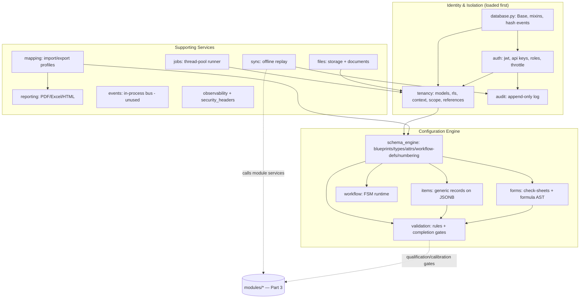
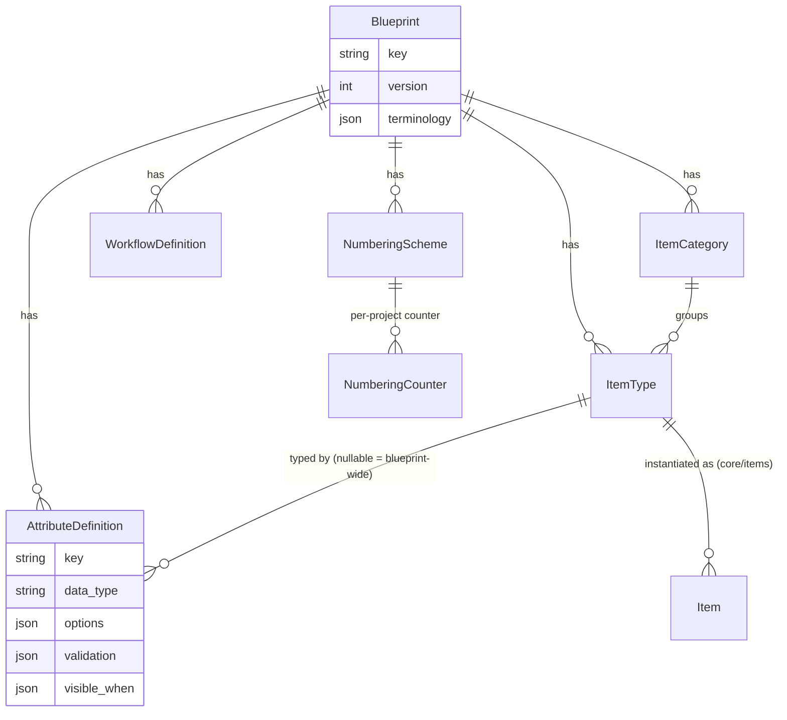

# Inspection ERP — Architecture Documentation Suite
## Part 2 · Mandatory Base Modules (Site-Wide Services)

> **Scope.** This is **Part 2** of the three-part suite. It documents the
> **mandatory, always-loaded platform services** under `backend/app/core/*` — the
> indispensable infrastructure every business module is built on. Unlike the
> `app/modules/*` features (Part 3), these are **never entitlement-gated**: their
> routers are mounted unconditionally in `app/main.py`, and their models/engines are
> imported for every request.
>
> Each module is documented against the **Four Architectural Pillars**:
> *What It Is · What It Does · How It Does It · Interactions & Dependencies*.
> Every claim is grounded in a concrete file; paths use `path:line`.

### What counts as a "base module" here

The platform's own ontology draws the line for us: `app/core/module_loader.py`
gates everything under `app/modules/*` behind per-tenant entitlements, while
`app/core/*` is loaded unconditionally. The base modules are therefore the
`core/*` packages:

| # | Base module | Path | Router? | Owns tables? |
|---|---|---|---|---|
| 1 | Tenancy & Isolation | `core/tenancy/` | `/api/v1/tenancy` | yes (`ie_core_organisation…project_member`) |
| 2 | Auth (IAM) | `core/auth/` | `/api/v1/auth` | yes (`ie_core_user`, `ie_core_api_key`) |
| 3 | Audit & Record Integrity | `core/audit/` + `database.py` | — | yes (`ie_core_audit_log`) |
| 4 | File & Document Storage | `core/files/` | `/api/v1/files` | yes (`ie_core_document`) |
| 5 | Background Jobs | `core/jobs/` | `/api/v1/jobs` | yes (`ie_core_job`) |
| 6 | Event Bus | `core/events.py` | — | no |
| 7 | Observability & HTTP Hardening | `core/observability.py`, `core/security_headers.py` | — (middleware) | no |
| 8 | Schema Engine (Blueprints) | `core/schema_engine/` | `/api/v1/schema` | yes (`ie_schema_*`) |
| 9 | Items | `core/items/` | `/api/v1/items` | yes (`ie_items_item`) |
| 10 | Workflow Engine | `core/workflow/` | — (engine) | no (defs live in schema engine) |
| 11 | Validation & Completion Gates | `core/validation/` | — (engine) | no |
| 12 | Forms / Check-sheets | `core/forms/` | `/api/v1/forms` | yes (`ie_forms_definition`) |
| 13 | Offline Sync | `core/sync/` | `/api/v1/sync` | yes (`ie_sync_operation`) |
| 14 | Reporting Renderers | `core/reporting/` | — (library) | no |
| 15 | Mapping / Import-Export | `core/mapping/` | `/api/v1/mapping` | no |
| 16 | Module Loader | `core/module_loader.py` | — | no (documented in Part 1 §2.5) |

**Documented-but-absent.** `docs/architecture.md` lists `core/notifications/` and
`core/search/` as core services; in the current tree **`notifications` does not
exist** and **`search` is an entitlement-exempt business module**
(`app/modules/search/`, covered in Part 3). The **event bus exists but has no
emitters/subscribers wired yet** (verified: zero `events.emit`/`subscribe` call
sites in `app/`) — it is ready infrastructure, documented honestly as such.

---

## Base dependency map

> **Coupling note.** Two base services deliberately reach *up* into business
> modules by calling their `service.py` (never their tables): the **sync engine**
> (`inspections`, `findings`) and two **completion gates** (`registers`). This is
> sanctioned — the base layer defines the contract and the module implements it —
> but it means those base services are not standalone-testable without those
> modules present. Flagged per-module below.

---

## 1 · Tenancy & Isolation — `core/tenancy/`

**1. What It Is.** The multi-tenancy substrate. The **Organisation is the tenant**;
every other record is scoped to it. This module owns the org/team/project hierarchy
and the machinery that guarantees one tenant can never see or touch another's data,
and that a user inside a tenant only reaches the projects they're assigned to.

**2. What It Does.**
- **Models** (`models.py`): `Organisation` (global mixin — it *is* the tenant),
  `OrgMember` (role: owner/admin/member/guest), `Team`, `TeamMember`, `Project`
  (unique `(tenant_id, code)`), `ProjectMember` (role: owner/admin/manager/inspector/
  reviewer/viewer).
- **API** (`/api/v1/tenancy`): project CRUD + members, org members, teams
  (`router.py` — `POST/GET /projects`, `/projects/{id}/members`, `/members`,
  `/teams`).
- **Services** (`service.py`): `get_project_or_404` — the cross-module way to
  resolve a project safely.
- **Isolation primitives** consumed platform-wide: `set_session_tenant`,
  `compute_project_scope`, `set_project_scope`, `require_tenant_id`.

**3. How It Does It.**
- **PostgreSQL RLS** (`rls.py`): every tenant table gets `ENABLE` + **`FORCE ROW
  LEVEL SECURITY`** and a policy `USING (tenant_id = NULLIF(current_setting(
  'app.tenant_id', true),'')::uuid)` with a matching `WITH CHECK`
  (`rls.py:61-76`). The per-request session var is set by `set_session_tenant`,
  **re-applied on every transaction** via an `after_begin` listener (`_rebind_tenant`),
  and **RESET on connection check-in** (`install_pool_reset`) so no request inherits a
  previous tenant. A deliberate `RLS_EXEMPT` set (`org_member`, `api_key`,
  `audit_log`, `job`, `portal_share`) covers bootstrap/worker tables (`rls.py:47-50`).
- **Request context** (`context.py`): `current_tenant_id` / `current_user_id`
  `ContextVar`s, set by the auth dependency.
- **Project scope** (`scope.py`, ADR 0014): a `do_orm_execute` listener injects
  `with_loader_criteria(project_id IN scope)` on *every* mapped model carrying a
  `project_id` (`scope.py:96-109`); a `before_flush` guard 404s out-of-scope writes
  (`scope.py:112-120`). Org owner/admin = unrestricted (`None` scope).
- **Reference guard** (`references.py`, H-09): a `before_flush` listener validates
  every new/re-pointed `project_id` belongs to the record's own tenant — one hook
  instead of ~20 per-router checks (`references.py:42-61`).

Persistence: `ie_core_organisation`, `ie_core_org_member`, `ie_core_team`,
`ie_core_team_member`, `ie_core_project`, `ie_core_project_member`.

**4. Interactions.**
- **Inbound:** *everything*. `auth/deps.get_current_context` calls
  `set_session_tenant` + `set_project_scope` on every request; every module model
  inherits isolation passively through the ORM listeners.
- **Outbound:** `database.py` (Base/engine/session), `audit` (project member
  changes). No external services.
- **Coupling:** synchronous, via SQLAlchemy ORM events (process-wide, implicit) and
  direct service calls.

---

## 2 · Authentication (IAM) — `core/auth/`

**1. What It Is.** Identity and access management: credential verification, token
issuance, API keys, role guards, and login throttling. It is the one place that
turns a credential into `(user, org, membership)` and binds the request's tenant
and project scope.

**2. What It Does.**
- **Endpoints** (`router.py`, `/api/v1/auth`): `POST /register`, `POST /login`,
  `POST /refresh`, `GET /me`, `POST /switch-org/{slug}`, and API-key CRUD
  (`POST/GET /api-keys`, `DELETE /api-keys/{id}`).
- **Dependencies** exported for every other router: `get_current_context`,
  `get_current_user`, `get_current_org`, and the `require_org_role(*roles)` factory.
- **Services** (`service.py`): `create_org_and_owner` (shared by `/register` and
  onboarding), `issue_tokens`, `unique_slug`.

**3. How It Does It.**
- **Passwords:** stdlib `hashlib.scrypt` (`N=2^14,r=8,p=1`), per-password salt,
  format `scrypt$N$r$p$salt$digest`, constant-time verify (`security.py:14-35`,
  ADR 0001).
- **JWT:** `HS256` signed with `IE_SECRET_KEY`; access 30 min, refresh 14 days;
  claims `sub/type/iat/exp/org`; `decode_token` rejects wrong token type
  (`security.py:38-65`).
- **API keys:** `ie_<token_urlsafe>`, **only the SHA-256 hash stored**, plaintext
  shown once; each key carries its own `tenant_id` so it both authenticates and
  selects the tenant (`security.py:68-76`, `models.py:26-38`).
- **Credential → context** (`deps.py`): `_authenticate` resolves API key or bearer
  → `(user, org_id)`; `get_current_context` loads the `OrgMember`, enforces
  **guest read-only** (non-safe method → 403 except org-switch), sets context vars,
  and calls `set_session_tenant` + `set_project_scope` (`deps.py:66-96`).
- **Session invalidation:** `User.password_changed_at` — tokens with earlier `iat`
  are rejected (`deps.py:59-60`).
- **Brute-force throttle** (`ratelimit.py`, H-14): in-process sliding window of
  *failed* logins per `(client_ip, email)`; 429 + `Retry-After` after
  `IE_LOGIN_MAX_FAILURES` (10) in `IE_LOGIN_WINDOW_SECONDS` (900).

Persistence: `ie_core_user` (global identity, may belong to many orgs),
`ie_core_api_key` (tenant-scoped, RLS-exempt).

**4. Interactions.**
- **Inbound:** every authenticated router depends on `get_current_context` /
  `require_org_role`; `module_loader`'s entitlement gate composes on top of it.
- **Outbound:** `tenancy` (membership, scope), `audit` (login/register/key events),
  `database` (session).
- **Coupling:** synchronous (FastAPI dependency injection). Throttle state is
  per-worker memory (Redis is the documented follow-up).

---

## 3 · Audit Log & Record Integrity — `core/audit/` + `database.py`

**1. What It Is.** The platform's tamper-evidence layer and the "Digital Trust"
record contract: an **append-only audit trail** plus a **content hash + revision**
maintained automatically on every record.

**2. What It Does.**
- `write_audit(db, *, entity_uri, action, actor_id?, tenant_id?, data?)` — the
  single insert path; there is **no update or delete** (`audit/service.py`).
- Global, automatic `hash`/`revision` maintenance for every record via the record
  mixins (`database.py`).

**3. How It Does It.**
- **Audit table** `ie_core_audit_log` (`audit/models.py:19`): actor, tenant,
  `entity_uri`, `action`, JSONB `data`. **RLS-exempt** because it's written from
  pre-auth flows and workers (`rls.py:48`); isolation is by explicit `tenant_id`
  filter at query time (ADR 0003).
- **Record contract** (`database.py`): `GlobalRecordMixin` / `TenantRecordMixin`
  give `id`, typed `entity_uri`, `created_at/by`, `modified_at/by`, `revision`,
  `source`, and SHA-256 `hash`. A `before_flush` listener (`database.py:131-140`)
  hashes on insert and bumps hash+revision on modify, over a canonical sorted-JSON of
  columns excluding `hash/modified_at/revision`. **No model can forget it** — a
  metadata contract test enforces the mixin on every table.

**4. Interactions.**
- **Inbound:** auth (login/register/key), tenancy, sync (`sync.applied`), and FSM
  transitions across business modules.
- **Outbound:** `database` only.
- **Coupling:** synchronous; the hash/revision half is implicit (ORM event), so it
  applies even to records written by code that never calls the audit service.

---

## 4 · File & Document Storage — `core/files/`

**1. What It Is.** The only sanctioned path to stored bytes. Records never hold raw
filenames or paths — they hold a `Document` id, and `Document` holds an opaque
`storage_key` (hard rule, `docs/architecture.md`).

**2. What It Does.**
- **API** (`/api/v1/files`): `POST /upload` (multipart), `GET` (list, project-scoped),
  `GET /{id}/download`.
- **Service helpers** for modules: `get_document_or_404`, `read_bytes`,
  `list_for_project` (all tenant-scoped — `service.py`).
- **Pluggable backends:** `local` (dev/test) and `s3`/MinIO (deploy), behind a
  `Storage` Protocol (`storage.py:19-63`).

**3. How It Does It.**
- `make_storage_key(tenant_id, filename)` → `"{tenant}/{uuid}{suffix}"` — tenant-
  prefixed, collision-free; the original name survives only in the DB record
  (`storage.py:71-74`).
- **Upload hardening** (H-10): `validate_magic_bytes` checks leading bytes against an
  extension allowlist (`storage.py:85-110`); the **served content type comes from an
  allowlist by extension, never the client header** (`content_type_for`,
  `storage.py:113-134`); `clean_filename` + RFC 6266/5987 `content_disposition`
  neutralise path/control/quote injection in download headers
  (`storage.py:137-152`).
- `LocalStorage._path` blocks path traversal (`storage.py:30-34`); `sha256_stream`
  records a content digest on the `Document`.

Persistence: `ie_core_document` (`project_id?`, `filename`, `content_type`, `size`,
unique `storage_key`, `sha256` — `models.py`).

**4. Interactions.**
- **Inbound:** reporting (stores rendered PDFs/Excel), scope ingest, archive export,
  any module attaching evidence.
- **Outbound:** filesystem or S3/MinIO (`boto3`, kept optional via the `s3` extra;
  `s3.py` is coverage-omitted).
- **Coupling:** synchronous service calls; storage backend is I/O.

---

## 5 · Background Jobs — `core/jobs/`

**1. What It Is.** Asynchronous work for long operations (PDF/OCR/CAD pipelines,
imports, archive builds), with a durable progress record the UI polls.

**2. What It Does.**
- `register_job(kind)` — decorator registering a handler
  `(db, job, update) -> dict`.
- `submit_job(db, *, kind, tenant_id, payload, created_by?)` — enqueue; returns the
  `JobRecord`.
- **API** (`/api/v1/jobs`): `GET /{job_id}` — status/progress/result/error.

**3. How It Does It.**
- **v0 runner** (`runner.py`, ADR 0002): a `ThreadPoolExecutor` (4 workers). Each job
  runs with its **own DB session**; `_run` loads the job and **adopts the job's
  tenant** via `set_session_tenant` so handler queries run under RLS as that tenant
  (which is *why* `ie_core_job` is RLS-exempt — the worker must read the row before
  it has a tenant) (`runner.py:56-95`).
- Progress persists through an `update(progress, message)` callback that commits to
  the record. A failing handler is captured, not raised; **the traceback goes to the
  server log only, users see a truncated message** (H-16).
- `set_synchronous(True)` runs jobs inline for tests. The interface is
  broker-agnostic so Dramatiq/Redis can replace the pool without touching callers.

Persistence: `ie_core_job` (`kind`, `status` queued/running/succeeded/failed,
`progress` 0–100, `message`, `payload`, `result`, `error`).

**4. Interactions.**
- **Inbound:** `scope_ingest`, `archive`, `p6_sync`, reporting-heavy flows
  (`register_job` call sites in `modules/*`).
- **Outbound:** `tenancy.rls` (tenant adoption), `database` (per-job session).
- **Coupling:** asynchronous (thread pool) with the **job record as the only shared
  state** — callers never hold a future.

---

## 6 · Event Bus — `core/events.py`

**1. What It Is.** A minimal in-process publish/subscribe bus for decoupling modules
(emit a domain event without importing the consumer).

**2. What It Does.** `subscribe(event, handler)`, `emit(event, payload)`,
`clear_subscribers()` (test hook).

**3. How It Does It.** A module-level `defaultdict(list)` of handlers; `emit`
invokes each handler and **swallows+logs exceptions** so one bad subscriber can't
break the emitter (`events.py:21-26`). Synchronous, in-process, no persistence,
no ordering guarantees beyond registration order.

**4. Interactions.** **Currently none** — there are no `emit`/`subscribe` call sites
in the codebase today. It is provided infrastructure awaiting adoption; modules
presently couple via direct `service.py` calls instead. **Failure mode:** inert if
unused; if adopted, a slow/throwing handler blocks the emitting request thread
(it's synchronous).

---

## 7 · Observability & HTTP Hardening — `core/observability.py`, `core/security_headers.py`

**1. What It Is.** The telemetry and baseline-security middleware wrapped around
every request (outermost in the stack — `main.py:23-24`).

**2. What It Does.**
- **Correlation & timing:** assigns/echoes `X-Request-ID`, times the request, adds
  `X-Response-Time-ms`, emits one structured access-log line
  (`observability.RequestContextMiddleware`).
- **Logging:** `configure_logging(log_format)` installs a text or JSON formatter +
  a request-id filter (`IE_LOG_FORMAT`).
- **Readiness:** `check_database(engine)` backs `GET /api/v1/health/ready`
  (503 if the DB can't round-trip `SELECT 1`); `GET /api/v1/health` is liveness.
- **Security headers** (`SecurityHeadersMiddleware`, H-15): `nosniff`, `X-Frame-
  Options: DENY`, referrer & permissions policy, **HSTS in prod**, and a strict
  **CSP on HTML responses** (SPA shell), exempting `/api/docs`.

**3. How It Does It.** Both are Starlette `BaseHTTPMiddleware`. The request-id lives
in a `ContextVar` so log records anywhere in the request pick it up
(`_RequestIdLogFilter`). Dependency-free (stdlib + Starlette) — no APM vendor
lock-in (ADR 0013). `IE_DATA_REGION` records residency for disclosure.

**4. Interactions.**
- **Inbound:** every request; orchestrator health checks (`docker-compose.yml`
  healthcheck → `healthcheck.py`).
- **Outbound:** stdout/aggregator (logs), `database` (readiness).
- **Coupling:** synchronous middleware; no shared state beyond the per-request
  context var.

---

## 8 · Schema Engine (Blueprints) — `core/schema_engine/`

**1. What It Is.** The **no-code core** the whole product sits on. Business shape —
entities, fields, workflows, numbering, terminology — lives as **versioned data**
(a *Blueprint*), not code. This is what lets the same platform be a CUI-inspection
tool or any other field-ops system by configuration.

**2. What It Does.**
- **Model hierarchy:** `Blueprint → ItemCategory → ItemType → AttributeDefinition`,
  plus `WorkflowDefinition` and `NumberingScheme`/`NumberingCounter` (`models.py`).
  14 attribute types (`TEXT…FORMULA, ENTITY_LINK`).
- **Studio API** (`/api/v1/schema`): blueprint CRUD, add categories/types/attributes/
  workflows/numbering, `GET /blueprints/{id}/resolve[?project_id=]`, blueprint
  **export/import** (portable key-based JSON — ADR 0010), and a **starter library**
  (`GET /library`, `POST /library/{key}/instantiate`).
- **Services:** `get_blueprint_or_404`, `load_resolved`, `bump_version`,
  `find_type_by_key` (`service.py`); `next_number` (`numbering.py`); `resolve_schema`
  (`resolution.py`); bundle export/import (`bundle.py`); library bundles
  (`library.py`).

**3. How It Does It.**
- **Resolution (instance → project)** (`resolution.py`): every child carries
  `project_id` — `NULL` = instance-wide, set = project override (same `key`) or
  addition (new `key`). `_merge_by_key` overlays project rows onto instance rows
  deterministically; attributes merge on `(item_type_id, key)` so the same key can
  exist on different types. The resolver is a **pure function** reused by the API,
  the items service and the importer (`resolution.py:30-93`).
- **Versioning:** `bump_version` increments `Blueprint.version` on structural edits;
  items store the version they were created under and store values by attribute
  *key*, so template edits never orphan data (`README.md`, `models.py:50`).
- **Numbering** (`numbering.py`): `next_number` row-locks the counter
  (`with_for_update`) so concurrent creates don't collide; patterns like
  `INS-{seq:03d}`/`{project_code}`, per-project or global, with a safe fallback on a
  malformed pattern.
- **Selector contract:** `SELECTOR`/`MULTISELECTOR` options are
  `[{key, displayText}]` and the **stored value is always the key** (Inspectivity
  parity, `README.md`).

Persistence: `ie_schema_blueprint`, `ie_schema_item_category`, `ie_schema_item_type`,
`ie_schema_attribute`, `ie_schema_workflow`, `ie_schema_numbering`,
`ie_schema_numbering_counter`.

**4. Interactions.**
- **Inbound:** `items` (builds records against resolved types), `validation`
  (validates against `AttributeDefinition`), `forms`, `workflow`, `mapping`
  (importer writes into a blueprint), onboarding (starter blueprint), every
  domain module whose shape is a blueprint.
- **Outbound:** `tenancy` (scope), `database`.
- **Coupling:** synchronous; the pure resolver is dependency-light and heavily
  reused.

---

## 9 · Items — `core/items/`

**1. What It Is.** The **generic record** whose shape is defined by a Blueprint
`ItemType` rather than by code — an inspection scope, a line, an asset, a finding.
The `MODULE → ITEM` parent/child structure mirrors Inspectivity's model.

**2. What It Does.** `/api/v1/items`: `POST` (create against a resolved type,
validating values and allocating a number), `GET /{id}`, `GET` (list, filtered by
project/type/parent). Values are validated and a `quality_score` is available.

**3. How It Does It.** `Item` (`models.py`) stores `project_id`, `blueprint_id`,
`item_type_id`, `parent_id` (self-FK), `number`, `title`, `status`,
`schema_version`, and a JSONB `attributes` map keyed by `AttributeDefinition.key`.
Composite indexes on `(project_id, item_type_id)` and `parent_id`. Creation resolves
the schema (`schema_engine.load_resolved`), runs `validation.validate_item_values`,
and allocates `numbering.next_number`.

Persistence: `ie_items_item`.

**4. Interactions.**
- **Inbound:** business modules that model their domain as items
  (`iso_workspace`, `scope_ingest`, `findings`…).
- **Outbound:** `schema_engine` (resolution, numbering), `validation`, `tenancy`.
- **Coupling:** synchronous.

---

## 10 · Workflow Engine — `core/workflow/`

**1. What It Is.** The **FSM runtime** that activates `WorkflowDefinition` rows
(states/transitions JSON) from the schema engine.

**2. What It Does.** Pure functions: `initial_state`, `is_terminal`,
`available_transitions(current, role?)`, `find_transition(current, target, role?)`
— returning typed `Transition`s (with `roles` and `gates`). `WorkflowError` on an
invalid/forbidden transition.

**3. How It Does It.** Parses the blueprint's transition JSON into `Transition`
dataclasses and filters by current state and role (`engine.py`). It is **purely
functional** — the one side-effecting step (`apply_transition`) is orchestrated by
the *caller* (the inspections service) so that gates + audit stay inside the
caller's transaction (`engine.py:1-11`). No tables of its own.

**4. Interactions.**
- **Inbound:** `inspections` (and any module with a lifecycle); it feeds transition
  `gates` into the validation engine.
- **Outbound:** `schema_engine` (definitions).
- **Coupling:** synchronous, in-process, stateless.

---

## 11 · Validation & Completion Gates — `core/validation/`

**1. What It Is.** Two rule families on one `Finding` shape: **attribute-level value
validation** and **completion gates** (the Trust-Phase-2 checks that must pass before
a record can be finalised — ADR 0005).

**2. What It Does.**
- `validate_item_values(attributes, values) -> [Finding]` and `quality_score(...)`
  (`engine.py`).
- `run_gates(ctx, gate_specs) -> [Finding]` with `register_gate(name)` and six
  built-ins: `required_responses`, `photos_present`, `supervisor_signoff`,
  `inspector_qualified`, `equipment_calibrated`, `procedure_approved` (`gates.py`).

**3. How It Does It.**
- **Value engine** (`engine.py`): per-`AttributeDefinition` type checks (NUMBER
  min/max, TEXT length/regex, SELECTOR/MULTISELECTOR option membership), honouring
  `visible_when` conditional visibility and `required`. Each `Finding` names the
  offending attribute key.
- **Gates** (`gates.py`): a `GateContext` carries server-derived data only — notably
  `required_response_keys` and `signoffs` come from the server, **never request
  input** (H-06). `supervisor_signoff` enforces **verifier ≠ resolver** (signer must
  differ from the inspector); an empty check sheet can never complete. Gate config is
  blueprint data (`transitions[].gates`), so *which* checks apply is a configuration
  decision.

No tables; both engines are pure over inputs.

**4. Interactions.**
- **Inbound:** `items` (value validation), `inspections`/`workflow` (gates on
  transitions).
- **Outbound (notable up-coupling):** two gates import
  `modules.registers.service.is_person_qualified` / `is_equipment_calibrated`
  (`gates.py:119,137`) — the base layer defines the gate, the business module
  supplies the data.
- **Coupling:** synchronous; the registers dependency is a direct service call.

---

## 12 · Forms / Check-sheets — `core/forms/`

**1. What It Is.** Versioned **check-sheet definitions** (sections → questions) as
Blueprint data, with a **safe formula engine** — so "custom check sheets" (Phase 4)
is pure configuration.

**2. What It Does.** `/api/v1/forms`: create, list, get, `PUT /{id}/sections`
(version bump), duplicate, and `POST /{id}/evaluate` (server-authoritative visibility
+ computed formula values). `compute_form_state(sections, responses)` resolves
visible sections/questions and computed values.

**3. How It Does It.**
- `FormDefinition` (`models.py`) stores a `sections` JSON of questions reusing the
  attribute type vocabulary plus check-sheet specifics (`critical`, `allow_na`,
  `requires_photo`); scoped by `(blueprint_id, key, project_id)`.
- **Restricted-AST formulas** (`evaluation.py`): `FORMULA` questions are evaluated
  with an `ast`-walking interpreter over a whitelist of operators and functions
  (`round/min/max/abs/sum`) — **never Python `eval`**. Bad references, non-numeric
  values, divide-by-zero, and non-finite results all yield `None` rather than raising
  (H-12). Conditional visibility reuses the schema-engine `visible_when` convention.
  Pure functions, so identical logic runs server-side (authoritative) and can be
  mirrored client-side for live UX.

Persistence: `ie_forms_definition`.

**4. Interactions.**
- **Inbound:** `inspections` (responses stored on the executing item), Studio
  check-sheet editor, validation gates (`required_responses` consumes answers).
- **Outbound:** `schema_engine` (blueprint linkage), `tenancy`.
- **Coupling:** synchronous.

---

## 13 · Offline Sync — `core/sync/`

**1. What It Is.** The **server half of the offline-first PWA**: applies a batch of
field mutations queued on a device, **idempotently** and **conflict-aware**
(server-wins — ADR 0007).

**2. What It Does.** `/api/v1/sync` `POST` accepts
`[{op_id, type, base_revision, payload}]` and returns per-op
`{op_id, outcome: applied|duplicate|conflict|error, …}`. `HANDLERS` maps op types to
module-service calls (`inspection.save_responses`, `finding.create`).

**3. How It Does It** (`service.py`).
- **Idempotency:** the first time an `op_id` is seen, its outcome is recorded in
  `ie_sync_operation` (unique `(tenant_id, client_op_id)`); a re-POST replays the
  stored result as `duplicate` without re-applying (`service.py:113-116`).
- **Conflict (server-wins):** a handler raises `ConflictError(server_state)` when the
  device's `base_revision` no longer matches the server row; the mutation is skipped
  and the current server state is returned for the client to diff
  (`service.py:54-64`).
- **Batch isolation:** each op runs in its own `begin_nested()` SAVEPOINT, so a bad
  op rolls back only its own changes, not the batch (`service.py:124-135`). Applied
  ops are audited (`sync.applied`).

Persistence: `ie_sync_operation`.

**4. Interactions.**
- **Inbound:** the PWA sync engine (`frontend/src/lib/offline/`).
- **Outbound (notable up-coupling):** calls `modules.inspections.service` and
  `modules.findings.service` directly (`service.py:40-41`) — never their tables; plus
  `audit`.
- **Coupling:** synchronous request handling; the client side is the async half.
  **Extending it is config-light:** register a handler in `HANDLERS` (arch §7).

---

## 14 · Reporting Renderers — `core/reporting/`

**1. What It Is.** A backend-agnostic **document rendering library** (no router, no
tables) consumed by the reporting module and others: one report model rendered to
PDF, Excel, or HTML (ADR 0006).

**2. What It Does.** A `ReportDoc` composed of typed `Block`s (`Heading`,
`Paragraph`, `KeyValues`, `Table`, `PhotoGrid`, `StatusBadge`, `Spacer`,
`PageBreak`) plus `Branding` (`model.py`). Renderers: `render_pdf(doc)` (ReportLab),
`render_xlsx(title, columns, rows)` (openpyxl), `render_html(doc)`.

**3. How It Does It.** `model.py` defines the block dataclasses and
`safe_color`/`safe_image_uri` guards. Each renderer walks the blocks: `pdf.py`
escapes XML-ish text so untrusted input can't crash ReportLab (`_x`), `excel.py`
has `spreadsheet_safe` (formula-injection guard on CSV/Excel cells), `html.py`
escapes text and guards image sources. The model is the single source; adding a
standard report means adding a template + a module `service.py` hook (arch §7).

**4. Interactions.**
- **Inbound:** `modules/reporting`, archive export, any module emitting documents.
- **Outbound:** `files` (persist rendered output), ReportLab/openpyxl.
- **Coupling:** synchronous library calls; pure transformation.

---

## 15 · Mapping / Import-Export — `core/mapping/`

**1. What It Is.** The import/export engine: a registry of **mapping profiles** for
external targets (so there are never one-off exporters — arch §7) plus the
**Inspectivity importer** that loads a legacy export into a Blueprint.

**2. What It Does.**
- **API** (`/api/v1/mapping`): `POST /inspectivity/import` (`router.py:31`).
- **Profiles** (`profiles/`): `PROFILES = {p.NAME: p for p in (xero, myob)}`; each
  exposes `NAME`, `DISPLAY_NAME`, `COLUMNS`, `to_rows(invoices)`. Helpers `to_csv`,
  `list_targets` (`profiles/__init__.py`). New accounting connector = drop a
  `profiles/<name>.py` (ADR 0012) — picked up automatically.
- **Inspectivity importer** (`inspectivity.py`): parses a legacy export into
  blueprint categories/types/attributes, preserving the `label`/selector-key contract
  the schema engine documents.

**3. How It Does It.** The profile registry is pure config discovered at import; the
importer writes through the schema engine's resolution model so imported shape obeys
the same instance/project rules. Mapping owns no tables.

**4. Interactions.**
- **Inbound:** `modules/accounting` (consumes `PROFILES`), Studio import UI.
- **Outbound:** `schema_engine` (importer target), `reporting`/`files` (exports).
- **Coupling:** synchronous; profiles are a plug-in registry.

---

## Base-layer failure modes (summary)

Because these are mandatory, "disabling" them is not a tenant-facing toggle — but
their failure characteristics matter:

| Base module | If it fails / is misconfigured |
|---|---|
| Tenancy/RLS | **App refuses to boot** in prod if the DB role can bypass RLS (`main.py:67-76`); otherwise zero rows leak (NULL tenant → no rows). |
| Auth | All authenticated routes 401; `IE_SECRET_KEY` default/short → **boot refused** in prod. |
| Audit/Integrity | Hash/revision is an ORM event — cannot be skipped per-model (contract test enforces the mixin). |
| Files | Upload/download fail; storage backend outage is isolated to file ops. |
| Jobs | Long ops never progress; the job record captures the error for the UI. In-process pool means jobs die with the process (not durable across restart). |
| Event bus | Inert (no subscribers today). |
| Observability | Logs/headers degrade; `/health/ready` returns 503 to drain the node. |
| Schema engine | Blueprint resolution failure blocks item/form/workflow creation for that blueprint. |
| Validation/gates | A gate's upstream (`registers`) missing → inspections can't finalise (fails safe/closed). |
| Sync | Per-op isolation + idempotency ledger mean one bad op or retry can't corrupt the batch. |

---

## Appendix · Base tables & their RLS status

| Table | Owner | RLS |
|---|---|---|
| `ie_core_user` | auth | global (no tenant) |
| `ie_core_api_key` | auth | tenant, **RLS-exempt** (pre-auth lookup) |
| `ie_core_organisation` | tenancy | global (is the tenant) |
| `ie_core_org_member` | tenancy | tenant, **RLS-exempt** (bootstrap) |
| `ie_core_team` / `_team_member` | tenancy | RLS |
| `ie_core_project` / `_project_member` | tenancy | RLS (+ project scope) |
| `ie_core_audit_log` | audit | tenant, **RLS-exempt** (append-only, pre-auth) |
| `ie_core_document` | files | RLS |
| `ie_core_job` | jobs | tenant, **RLS-exempt** (worker adopts tenant) |
| `ie_schema_*` (7 tables) | schema engine | RLS (+ project scope on child rows) |
| `ie_items_item` | items | RLS (+ project scope) |
| `ie_forms_definition` | forms | RLS (+ project scope) |
| `ie_sync_operation` | sync | RLS |

---

*End of Part 2. Part 3 (Optional / Extension Modules) applies the same Four Pillars
to each of the 25 entitlement-gated business modules under `app/modules/*`.*
