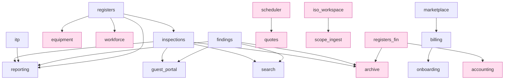

# Inspection ERP — Architecture Documentation Suite
## Part 3 · Optional / Extension Modules

> **Scope.** This is **Part 3** of the three-part suite. It documents the **25
> business feature modules** under `backend/app/modules/*` — everything built *on
> top of* the base layer (Part 2). Each is documented against the **Four
> Architectural Pillars** (*What It Is · What It Does · How It Does It ·
> Interactions, incl. failure modes*). Every claim is grounded in a concrete file.

### The entitlement model (what "optional" means here)

The module loader (`core/module_loader.py:97-113`) gates each module by its
manifest `category` against `marketplace.ALWAYS_ON_CATEGORIES = {"core",
"platform"}` (`modules/marketplace/service.py:33`):

- **Always-on** (`core`, `platform`) — entitled for every tenant, cannot be toggled
  off (`is_entitled` returns `True` unconditionally). These are the product's spine.
- **Optional / pluggable add-ons** (`company`, `department`) — mounted with
  `Depends(require_entitlement(name))`; a tenant without an `active`/`trial`
  entitlement row gets **HTTP 402** on every route (`marketplace/deps.py`).

| Category | Gated? | Modules |
|---|---|---|
| `core` | no (always-on) | `system`, `findings`, `inspections`, `itp`, `registers`, `reporting`, `search` |
| `platform` | no (always-on) | `marketplace`, `billing`, `onboarding`, `guest_portal` |
| `department` | **yes** | `archive`, `iso_workspace`, `p6_sync`, `quotes`, `registers_fin`, `scheduler`, `scope_ingest` |
| `company` | **yes** | `accounting`, `daily_diary`, `equipment`, `estimating`, `hse`, `procurement`, `workforce` |

Every module follows the same contract (`docs/architecture.md §2`): `manifest.py`,
`models.py` (`ie_<module>_*` tables, `BaseRecordMixin`), `schemas.py`, `router.py`
(auto-mounted at `/api/v1/<prefix>`), `service.py` (the only cross-module entry),
`permissions.py`, `tests/`, `README.md`. **No module edits `main.py` or touches
another module's tables.**

### Inter-module dependency graph (from manifests)

> **Coupling is always synchronous service calls** (`import other.service`), never
> table access or the (unused) event bus. The base layer reaches *up* in exactly
> two sanctioned places (Part 2 §11, §13): completion gates call
> `registers.service`, and the sync engine calls `inspections`/`findings` services.

---

# A · Always-on Core Modules

## A1 · `inspections` (`/api/v1/inspections`) — the verified loop keystone

**What It Is.** The core inspection record and its **gated, auditable lifecycle** —
the heart of the "Digital Trust Layer". `category=core`, `depends=["registers"]`.

**What It Does.** 6 endpoints + a rich service: `create_inspection`,
`save_responses`, `sign_off`, `transition`, `list_for_project`, `status_counts`,
`search`, `required_response_keys`, `is_locked`. Tables `ie_inspections_inspection`
(status, responses JSON, context JSON, workflow_id, form_id, inspector_id, geo) and
`ie_inspections_transition` (FSM history).

**How It Does It** (`service.py`).
- Lifecycle runs on the **workflow engine** (Part 2 §10): a configured
  `WorkflowDefinition` or the built-in default `scheduled → in_progress →
  completed(terminal)` (`service.py:25-34`).
- `transition()` resolves the transition, **runs its completion gates first**
  (`validation.run_gates`), and blocks with **422 + findings** if any error gate
  fails (`service.py:257-274`). Every transition writes a `TransitionLog` row and an
  audit entry.
- **Anti-forgery (H-06):** `required_response_keys` is derived **server-side** from
  the check-sheet's visible required/critical questions (`service.py:63-83`);
  sign-offs are recorded only via `sign_off()` with the **server's** actor id and
  timestamp (never request input — `service.py:220-238`), which is what makes the
  `supervisor_signoff` gate's *verifier ≠ inspector* rule unforgeable. Terminal
  records are **locked** (read-only, 409 on edit; signed-off fields can't change).

**Interactions.** Inbound: `reporting`, `search`, `guest_portal`, `archive`, and the
offline `sync` engine (`inspection.save_responses`). Outbound: `registers` (gate
data via validation), `forms`, `schema_engine/workflow`, `audit`. **Failure:** core
— always on; if `registers` data is missing, qualification/calibration gates fail
closed and an inspection simply cannot be finalised.

## A2 · `registers` (`/api/v1/registers`) — qualifications & calibrations

**What It Is.** The authoritative register of **who is qualified** and **what
equipment is calibrated** — the evidence the completion gates check.
`category=core`.

**What It Does.** `ie_registers_qualification`, `ie_registers_calibration`. Service:
`is_person_qualified`, `is_equipment_calibrated`, `qualifications_for_person`,
`calibrations_for_equipment`, `expiring_qualifications`, `expiring_calibrations`
(4 routes).

**How It Does It.** Validity is date-windowed; the gate helpers answer a boolean
"current as of date". This is the module the **validation gates import directly**
(`core/validation/gates.py:119,137`) — the one sanctioned base→module up-call.

**Interactions.** Inbound: `inspections` (via gates), `equipment`, `workforce`,
`reporting`. **Failure:** core; expiry queries drive mobilisation/allocation
warnings elsewhere.

## A3 · `findings` (`/api/v1/findings`) — punch/NCR items

**What It Is.** Defect/punch/non-conformance records raised against a project or
inspection. `category=core`, no deps.

**What It Does.** `ie_findings_finding`. Service: `create_finding`, `search`,
`list_for_project`, `status_counts`, `open_count` (3 routes). Supports a
`source="field"` creation path used by the offline sync engine with geo-stamps.

**How It Does It.** Simple CRUD + lexical `search` helper (composed by the `search`
module). **Interactions.** Inbound: `reporting`, `search`, `guest_portal`,
`archive`, `sync` (`finding.create`). **Failure:** core.

## A4 · `itp` (`/api/v1/itp`) — Inspection & Test Plans

**What It Is.** ITP definitions and their activities with progress rollup.
`category=core`. **What It Does.** `ie_itp_plan`, `ie_itp_activity`; service
`list_for_project`, `activities`, `progress` (5 routes). **How It Does It.** Progress
is computed from activity state. **Interactions.** Inbound: `reporting` (ITP status
report). **Failure:** core.

## A5 · `reporting` (`/api/v1/reporting`) — branded reports & dashboards

**What It Is.** The module that turns records into **branded PDF/HTML/Excel** and
org/project dashboards. `category=core`,
`depends=["inspections","itp","findings","registers"]`.

**What It Does.** `ie_reporting_branding` (per-tenant logo/colours),
`ie_reporting_template` (custom JSON templates). Service `get_branding`,
`resolve_template` (7 routes). Renders standard reports (inspection report, ITP
status, campaign summary, findings register) and a zero-code custom-template engine.

**How It Does It.** Composes data from its four dependency modules' **services**
(never their tables), builds a `core/reporting.ReportDoc`, and renders via
`render_pdf`/`render_xlsx`/`render_html` (Part 2 §14), persisting output through
`files`. Custom templates resolve per tenant/project.

**Interactions.** Outbound: `core/reporting`, `files`, and the four domain services.
**Failure:** core; a report over a disabled add-on simply omits that data.

## A6 · `search` (`/api/v1/search`) — global search & saved views

**What It Is.** Cross-entity lexical search and per-user **saved views**.
`category=core`, `depends=["inspections","findings"]`. **What It Does.**
`ie_search_saved_view`; service `global_search`, `create_view`, `list_views`,
`get_view_or_404`, `delete_view` (4 routes). **How It Does It.** `global_search`
**composes each module's own `search()` helper** (inspections, findings, …) rather
than querying their tables — the extension pattern in `docs/architecture.md §7`.
**Failure:** core; extends to new entities by adding a `search()` to that module.

## A7 · `system` (`/api/v1/system`) — platform metadata

**What It Is.** The reference module that *proves the module contract* (P0-03) and
exposes platform/module metadata. `category=core`, `enabled=True`, no deps, no
tables (1 route). **Failure:** core; purely informational.

---

# B · Always-on Platform Modules (the SaaS spine)

## B1 · `marketplace` (`/api/v1/marketplace`) — entitlements & catalog

**What It Is.** The **single source of truth for "can this tenant use module X"**.
`category=platform`, no deps.

**What It Does.** `ie_marketplace_entitlement` (per-tenant, per-module row: status
`active|trial|disabled`, `expires_at`, `plan`, `subscription_id`). Service:
`is_entitled`, `is_always_on`, `catalog`, `set_entitlement`, `tenant_toggle`,
`remove_entitlement` (4 routes). Exports the `require_entitlement` dependency used by
the loader and every gated router.

**How It Does It** (`service.py`).
- `is_entitled` = always-on category → `True`; else a row that is `active`, or a
  `trial` not past `expires_at`, grants access; no row → not entitled (opt-in).
- **`tenant_toggle` (H-02):** a tenant admin may only flip a **billing-owned** row
  (`subscription_id` set) between its granted status and `disabled`; tenants
  **cannot grant themselves** add-ons (that's billing's job) — anything else is 402
  (`service.py:146-166`).
- `catalog` returns every loaded module with its per-tenant state for the nav/upsell
  UI.

**Interactions.** Inbound: module loader (gate), every add-on router, frontend nav
(`/marketplace/catalog`), `billing` (writes rows). **Failure:** platform — if it
misbehaved, add-ons would be uniformly denied (fail-closed), never over-granted.

## B2 · `billing` (`/api/v1/billing`) — subscriptions → entitlements

**What It Is.** Subscriptions as the *cause*; marketplace rows as the *effect*.
`category=platform`, `depends=["marketplace"]`.

**What It Does.** `ie_billing_subscription`. Service: `subscribe`, `cancel`,
`get_subscription`, `plan_modules`, and the webhook trio `sign_webhook`,
`verify_webhook_signature`, `handle_webhook` (5 routes). Plans are **config, not a
table** (`plans.py`): `free`, `field`, `office`, `pro`, `trial`, with `ALL_ADDONS`
("*") and `SELF_SERVE_PLANS = {free, trial}`.

**How It Does It** (`service.py`).
- `_sync_entitlements` reconciles exactly the rows this subscription owns to the
  plan's modules (resolved live against the registry), preserving a tenant's H-02
  opt-out across syncs and revoking modules the plan no longer covers
  (`service.py:52-74`).
- **Fail-closed security (H-01):** webhooks require an HMAC `t=<unix>,v1=<hex>`
  signature; `verify_webhook_signature` is constant-time, enforces a 300 s replay
  window, and **returns `False` when no secret is set** (`service.py:143-155`). Only
  a **verified provider event** (`via_provider=True`) can put a tenant on a paid
  plan; self-serve callers are limited to `free`/`trial`, trial once per tenant
  (`service.py:77-98`). `handle_webhook` binds the target tenant's RLS context before
  writing (unauthenticated callback — `service.py:158-190`).

**Interactions.** Outbound: `marketplace` (drives rows), `tenancy` (webhook tenant
bind). Inbound: `onboarding`. **Failure:** platform; without a webhook secret, paid
plans can only be granted by an operator — a deliberate safe default.

## B3 · `onboarding` (`/api/v1/onboarding`) — self-serve signup

**What It Is.** Turns a signup into a usable tenant. `category=platform`,
`depends=["billing"]` (1 route).

**What It Does / How.** `signup` (`service.py`): (1) creates user+org+owner via the
shared `auth.service.create_org_and_owner`; (2) starts the 14-day `trial`
subscription via `billing.subscribe` (→ all add-ons entitled); (3) instantiates a
**starter blueprint** from the schema-engine library so Studio/inspections work day
one; (4) issues tokens. No tables of its own.

**Interactions.** Outbound: `auth`, `billing`, `schema_engine` (library). **Failure:**
platform; a failure here blocks new-tenant creation but not existing tenants.

## B4 · `guest_portal` (`/api/v1/portal`) — read-only client share links

**What It Is.** Public, account-less **read-only project snapshots** for clients.
`category=platform`, `depends=["inspections","findings"]`.

**What It Does.** `ie_portal_share` (RLS-exempt token table). Service `create_share`,
`list_shares`, `get_share_or_404`, `revoke_share`, `snapshot` (4 routes): admins mint
a share token; public `GET /portal/view/{token}` returns a scoped snapshot (project
header + inspections + findings).

**How It Does It.** The token is resolved **before any tenant context exists** (hence
the RLS-exempt table), then the session is bound to the share's tenant — the same
**establish-then-bind** pattern as API-key auth (`service.py` docstring, ADR 0011).
Snapshot composes other modules' services; widen it in `service.snapshot`.

**Interactions.** Outbound: `inspections`, `findings`, `tenancy.rls`. **Failure:**
platform; a revoked/expired token 404s — no data leaks.

---

# C · Optional Department Add-ons (entitlement-gated)

## C1 · `iso_workspace` (`/api/v1/iso`) — drawing-centric measurement

**What It Is.** The drawing-centric ISO/P&ID workspace: calibrate a drawing, mark it
up, and write measurements back to item attributes. `category=department`, no deps.

**What It Does.** `ie_iso_drawing`, `ie_iso_markup`. Service `create_drawing`,
`calibrate`, `add_markup`, `list_markups`, `apply_measurement` (6 routes).

**How It Does It.** `calibrate` records a scale from a known reference;
`apply_measurement` converts pixel geometry to real units and writes the value onto
the subject **Item** via `core/items.service` (never the items table). **Interactions.**
Outbound: `items`, `files` (the drawing). Inbound: `scope_ingest`. **Failure:**
disabled → `/iso/*` returns 402; inspections/items unaffected.

## C2 · `scope_ingest` (`/api/v1/scope-ingest`) — master-scope → per-line items

**What It Is.** The productised `cui-inspection-processor`: ingest a master scope
document and split it into per-line packages + items after human confirmation.
`category=department`, `depends=["iso_workspace"]`.

**What It Does.** `ie_scope_ingest`. Service `create_ingest`, `confirm`,
`get_or_404` (4 routes). **How It Does It.** Upload → **background job** extraction →
review → `confirm` creates items. Extraction is **pluggable by content type** via
`extract.EXTRACTORS` (e.g. `text/csv` maps header→attribute keys); the review/confirm
path is identical regardless of source (so a real OCR extractor slots in without
touching the UI — `docs/architecture.md §7`). Pure extractors, no I/O.

**Interactions.** Outbound: `files`, `jobs`, `items`, `iso_workspace`. **Failure:**
disabled → 402; AI-assisted ingest is optional, manual item creation still works.

## C3 · `p6_sync` (`/api/v1/p6`) — Primavera P6 as a first-class citizen

**What It Is.** XER/CSV import, diff-based re-sync, and progress write-back for
Primavera P6. `category=department`, no deps.

**What It Does.** `ie_p6_import`, `ie_p6_activity`. Service `diff`, `sync_activities`,
`set_progress`, `rollup`, `writeback_csv`, `existing_activities` (5 routes).

**How It Does It** (`xer.py`, `service.py`). A **pure parser** reads Primavera's
tab-delimited XER (`%T/%F/%R/%E` records) or CSV into normalised activity rows
(PROJWBS→areas, TASK→activities); `diff` compares against staged rows for a
re-import; `set_progress`/`rollup` track completion; `writeback_csv` exports progress
back to P6. Add a format by registering a parser and dispatching it from
`parse_activities` (`docs/architecture.md §7`).

**Interactions.** Outbound: `files` (uploads), `tenancy`. Peer: `scheduler` is the
native alternative when no P6 plan exists. **Failure:** disabled → 402; the native
`scheduler` covers jobs that arrive without a P6 plan.

## C4 · `scheduler` (`/api/v1/scheduler`) — native lightweight scheduler

**What It Is.** A native scheduler for recurring re-inspections when there's no P6
plan. `category=department`, no deps. **What It Does.** `ie_scheduler_job`; service
`create_job`, `assign`, `transition`, `generate_recurrence`, `list_jobs` (5 routes).
**How It Does It.** `recur.py` expands recurrence rules into future jobs; jobs have
their own state machine (`JOB_STATES`). **Interactions.** Inbound: `quotes`
(accepted quote → scheduled job). **Failure:** disabled → 402.

## C5 · `quotes` (`/api/v1/quotes`) — rate cards & quotes → jobs

**What It Is.** Rate-card pricing and quotes that convert to scheduled jobs.
`category=department`, `depends=["scheduler"]`. **What It Does.**
`ie_quotes_rate_card`, `ie_quotes_quote`; service `create_card`, `create_quote`,
`transition`, `accept_and_convert`, `render_quote_pdf`, `variance` (8 routes).
**How It Does It.** Quote lines price against a rate card; `accept_and_convert` calls
`scheduler.service` to create the job; `render_quote_pdf` uses `core/reporting`.
**Interactions.** Outbound: `scheduler`, `core/reporting`. **Failure:** disabled →
402; sits upstream of scheduling, so its absence just removes the quote→job path.

## C6 · `registers_fin` (`/api/v1/fin-registers`) — invoice & docket registers

**What It Is.** Commercial registers of invoices and dockets. `category=department`,
no deps. **What It Does.** `ie_registers_entry`; service `create_entry`, `set_status`,
`list_entries`, `export_xlsx` (4 routes). **How It Does It.** Status-tracked entries;
Excel export via `core/reporting`. **Interactions.** Inbound: `archive` (handover),
`accounting` (export source). **Failure:** disabled → 402; accounting export and
archive lose this data source.

## C7 · `archive` (`/api/v1/archive`) — ISO-compliant handover package

**What It Is.** A self-contained, verifiable handover archive for a project.
`category=department`, `depends=["inspections","findings","registers_fin"]`.
**What It Does.** No tables; service `build_manifest`, `build_package` (2 routes,
typically via a background job). **How It Does It** (`build.py`). Pure ZIP assembly:
a **template-driven folder tree** (`ARCHIVE_TREE`, overridable as blueprint data)
containing the project's documents, a **clean** business-only JSON/Excel export, and
a **re-importable system backup** (full records with hashes) so a project can be
reconstituted. **Interactions.** Outbound: `files`, the three dependency services,
`core/reporting`, `jobs`. **Failure:** disabled → 402; no archive packages can be
built, but source records are untouched.

---

# D · Optional Company Add-ons (entitlement-gated)

## D1 · `workforce` (`/api/v1/workforce`) — people, crews, mobilisation, timesheets

**What It Is.** The workforce layer: people with a quals matrix, crews, mobilisation,
and timesheets. `category=company`, `depends=["registers"]` (12 routes — the largest
module). **What It Does.** `ie_workforce_person/_crew/_crew_member/_mobilisation/
_timesheet`; service incl. `create_person`, `quals_matrix`, `create_crew`,
`add_member`, `mobilise`, `project_roster`, `log_time`, `list_timesheets`.
**How It Does It.** `quals_matrix` joins people against `registers` qualifications;
mobilisation assigns crews to projects with status tracking; timesheets accrue per
person/project. **Interactions.** Outbound: `registers`. **Failure:** disabled →
402; inspections still run (inspector qualification is checked via `registers`
directly, not workforce).

## D2 · `equipment` (`/api/v1/equipment`) — plant register & allocation

**What It Is.** Equipment/plant register with allocation, utilisation, and
calibration-due tracking. `category=company`, `depends=["registers"]` (8 routes).
**What It Does.** `ie_equipment_item`, `ie_equipment_allocation`; service
`create_equipment`, `allocate`, `set_status`, `utilisation`, `dues`,
`allocations_for_equipment`. **How It Does It.** `dues` reads calibration validity
from `registers`; `utilisation` aggregates allocation windows. **Interactions.**
Outbound: `registers`. **Failure:** disabled → 402; calibration gates still work via
`registers` directly.

## D3 · `estimating` (`/api/v1/estimating`) — norms, estimates, variations, dayworks

**What It Is.** Production-norm estimating with variations and dayworks.
`category=company`, no deps (8 routes). **What It Does.** `ie_estimating_norm/
_estimate/_variation/_daywork`; service `create_norm`, `create_estimate`,
`create_variation`, `transition_variation`, `create_daywork`. **How It Does It.**
Estimates apply production norms to quantities; variations have their own
state machine. **Failure:** disabled → 402; standalone commercial tooling.

## D4 · `procurement` (`/api/v1/procurement`) — POs & deliveries

**What It Is.** Slim procurement: purchase orders and deliveries. `category=company`,
no deps (5 routes). **What It Does.** `ie_procurement_po`, `ie_procurement_delivery`;
service `create_po`, `transition_po`, `record_delivery`, `list_deliveries`.
**How It Does It.** POs carry a state machine; deliveries reconcile against PO lines.
**Failure:** disabled → 402.

## D5 · `daily_diary` (`/api/v1/daily-diary`) — site diary

**What It Is.** A daily site diary per project/date. `category=company`, no deps
(3 routes). **What It Does.** `ie_daily_diary`; service `upsert`, `get_for_date`,
`list_for_project`. **How It Does It.** One upsertable record per (project, date).
**Failure:** disabled → 402.

## D6 · `hse` (`/api/v1/hse`) — HSE incidents

**What It Is.** HSE incident lifecycle: report → investigate → close.
`category=company`, no deps (5 routes). **What It Does.** `ie_hse_incident`; service
`create_incident`, `update_investigation`, `transition`, `summary`,
`list_for_project`. **How It Does It.** Incident state machine with an investigation
payload; `summary` aggregates for dashboards. **Failure:** disabled → 402.

## D7 · `accounting` (`/api/v1/accounting`) — Xero/MYOB export

**What It Is.** Accounting connectors that export invoices to external systems.
`category=company`, `depends=["registers_fin"]` (3 routes). **What It Does.** No
tables; service `export_invoices`, `push_invoices`. **How It Does It.** Uses the
**`core/mapping` profile registry** (`PROFILES = {xero, myob}`, ADR 0012): adding a
connector = dropping a `core/mapping/profiles/<name>.py` with
`NAME/DISPLAY_NAME/COLUMNS/to_rows` — picked up automatically, no code change here.
**Interactions.** Outbound: `registers_fin` (invoice source), `core/mapping`.
**Failure:** disabled → 402; invoices remain in `registers_fin`, just not exported.

---

## Cross-cutting: how every extension module integrates with the base layer

| Base service | How extension modules use it |
|---|---|
| **Auth/Tenancy** | Every router depends on `get_current_context`; tenant + project scope are applied automatically (ORM listeners). Project-scoped register lists take a **required** `project_id`. |
| **Entitlements** | `company`/`department` routers are gated at the loader; no per-router code needed. 402 = not in plan. |
| **Audit/Integrity** | Every write carries hash/revision (ORM event); lifecycle actions call `write_audit`. |
| **Schema engine** | Domain shape (types, attributes, workflows, numbering, terminology) is blueprint config, resolved per project. |
| **Validation/Workflow** | Lifecycle modules (`inspections`, `hse`, `procurement`, `estimating`, `scheduler`, `quotes`) run the FSM engine + completion gates. |
| **Jobs** | Heavy flows (`scope_ingest`, `archive`, `p6_sync`) run on the thread-pool runner with progress records. |
| **Files/Reporting/Mapping** | Documents go through `files`; outputs render via `core/reporting`; import/export via `core/mapping` profiles. |
| **Sync** | `inspections`/`findings` expose the services the offline engine replays into. |

## Global failure-mode summary

- **Disabling an always-on module (`core`/`platform`)** is not possible via
  entitlements — they are the spine; only code/config changes remove them, and
  dependents would fail to load (the loader's toposort errors on a missing
  dependency).
- **Disabling an optional add-on** flips its routes to **402** and hides its nav; the
  platform keeps working. Dependents degrade predictably: e.g. without `registers_fin`
  the `archive` package omits financial records and `accounting` has nothing to
  export; without `scheduler` the `quotes` accept→job path is unavailable.
- **Misconfiguration** fails safe: missing entitlement → denied (not over-granted);
  missing gate data → inspection can't finalise (not silently passed); unsigned
  billing webhook → rejected (not trusted).

---

*End of Part 3 — and of the Architecture Documentation Suite.*
*Part 1 = `01-core-platform.md` · Part 2 = `02-base-modules.md` · Part 3 = this file.*
